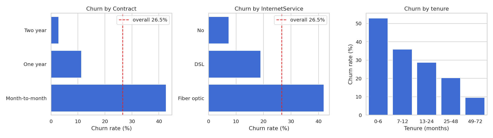
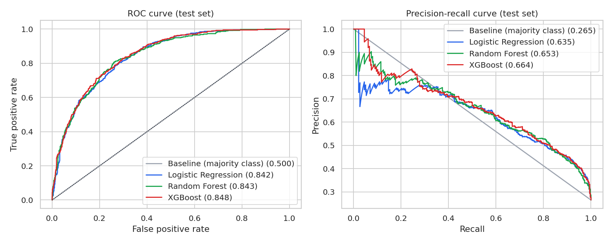
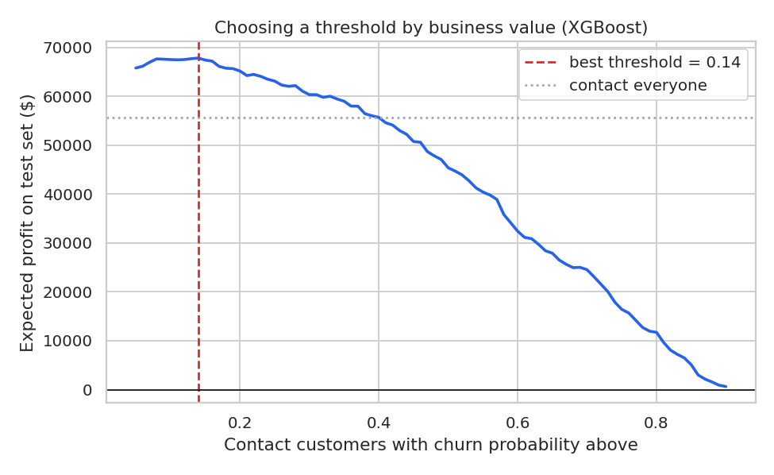
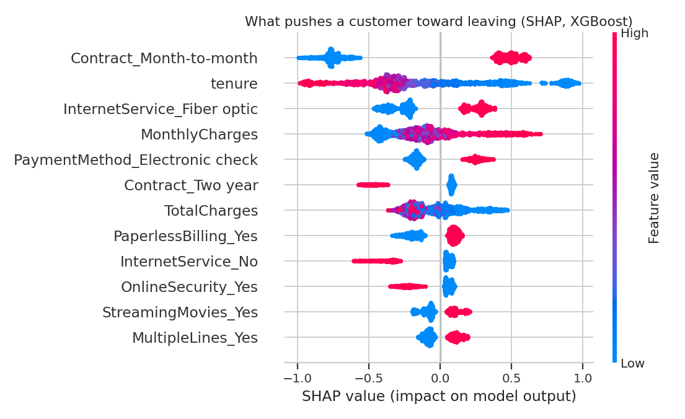

# Customer Churn: Analysis, Prediction and Explanation

[](https://belal0155.github.io/churn-demo/)


A telecom company loses about 1 in 4 customers. This project answers three questions:

1. **Who is likely to leave?** A model scores every customer (ROC-AUC 0.85 on held-out data).
2. **Why?** SHAP and permutation importance show which factors drive each prediction.
3. **What should the business do?** A cost-based threshold turns scores into a contact list for a retention offer.

**[Try the live demo](https://belal0155.github.io/churn-demo/)**: enter a customer profile and see the churn probability and the reasons behind it, computed in your browser.

## Data and license

**Dataset.** IBM Telco Customer Churn sample dataset: 7,043 customers, 20 features (contract, tenure, services, billing, payment method), 26.5% churned. It is a fictional sample dataset that IBM published for teaching, not company production data.

**Source.** IBM Business Analytics Community post "Telco customer churn": https://community.ibm.com/community/user/businessanalytics/blogs/steven-macko/2019/07/11/telco-customer-churn-1113 . A widely used copy is on Kaggle (`blastchar/telco-customer-churn`, listed as "Data files (c) Original Authors"). IBM does not state a license for the data, so it is **not included in this repository**. It remains under IBM's rights and terms.

**Get the data.** Run `python scripts/download_data.py` once. It downloads the file from IBM's own GitHub repository (`IBM/telco-customer-churn-on-icp4d`), checks its checksum and saves it as `data/telco_churn.csv.gz`.

**Citation.** IBM Business Analytics Community, "Telco customer churn" (sample data set), Steven Macko, 11 July 2019, URL above.

**License.** The MIT License covers only the code, text and figures I wrote. It does not cover the IBM dataset.

## Key findings

- **Contract type is the strongest signal.** Month-to-month customers churn at 42.7%, one-year at 11.3%, two-year at 2.8%.
- **The first year is the danger zone.** Customers with tenure of 12 months or less churn at 47.4%, later customers at 17.1%.
- **Fiber optic customers churn at 41.9%**, DSL at 19.0%, no internet at 7.4%. Paying by electronic check and having no online security add-on also push risk up.
- Permutation importance on the final model agrees: `Contract`, `tenure` and `InternetService` cause by far the largest AUC drops when shuffled.



## Method

| Step | What I did | Why |
|---|---|---|
| Cleaning | `TotalCharges` is text; its 11 blank rows all have `tenure = 0` (never billed), so they are set to 0 and a test asserts that. "No internet/phone service" folded into "No" for add-ons. | Fix data problems from evidence, not by default imputation |
| Split | 80/20 stratified train/test split, test set untouched until the end | Honest final estimate |
| Pipelines | Encoding and scaling live inside scikit-learn `Pipeline`s, fitted on training folds only | No leakage |
| Models | Majority-class baseline, Logistic Regression, Random Forest, XGBoost (light randomized search on the training set only) | Show a simple model, a bagged model and a boosted model against a floor |
| Selection | By 5-fold cross-validated ROC-AUC, not by test score | Avoid picking on the test set |
| Evaluation | ROC-AUC, PR-AUC, Brier score, calibration, confusion matrix | One number is not enough for an imbalanced target |
| Decision | Threshold chosen by expected profit with explicit, editable assumptions | A model is useful when it changes an action |
| Explanation | SHAP (XGBoost), permutation importance, logistic regression coefficients | Explain customers, not only rank them |

## Results

| Model | CV ROC-AUC (5-fold) | Test ROC-AUC | Test PR-AUC | Brier score |
|---|---|---|---|---|
| Baseline (majority class) | 0.500 | 0.500 | 0.265 | 0.195 |
| Logistic Regression | 0.846 ± 0.012 | 0.842 | 0.635 | 0.138 |
| Random Forest | 0.844 ± 0.011 | 0.843 | 0.653 | 0.136 |
| **XGBoost (selected)** | **0.849 ± 0.012** | **0.848** | **0.664** | **0.135** |

The three models are within noise of each other on ROC-AUC. A plain logistic regression is almost as good as XGBoost, so in a real project I would weigh that against the extra complexity. The demo uses the logistic regression because its reasoning can be read directly from its coefficients.



### From scores to a decision

Assumptions (change them in `churn/modeling.py`): a retention offer costs $30 per contacted customer, saves 30% of customers who would really leave, and a saved customer is worth 12 months of their bill.

On the test set, contacting customers with churn probability above **0.14** gives a **simulated expected profit** of about **$67.8k**, against $55.7k for contacting everyone, at 91% recall and 44% precision. These dollars are not real revenue. They come from the assumed offer cost, save rate and customer value above, applied to a public sample dataset. The profit curve is flat at the low end, so the exact threshold matters less than the idea of picking it with costs in mind. Change the cost assumptions and the best threshold moves.



### Explanations



Month-to-month contracts, short tenure, fiber optic service and electronic-check payment push the prediction toward churn. Two-year contracts and no internet service push it away. Calibration and the confusion matrix are in `reports/figures/`.

## Limitations

- Public sample data. It has no dates, so there is no time-based validation, and results will not transfer to another company without retraining.
- Correlation, not causation. Fiber optic customers churn more, but this data does not say that fiber causes it (price, competition or service quality could).
- The profit numbers depend on assumed costs and save rates. They show the method, not a business case.
- Fairness: `gender` and `SeniorCitizen` are in the data. The logistic coefficient for gender is near zero, but a production system would need a proper fairness review before using age-related fields.

## Run it

```bash
python -m venv .venv && source .venv/bin/activate
pip install -r requirements.txt
python scripts/download_data.py   # fetches the IBM sample data (not bundled)
python -m churn.run     # trains, evaluates, writes reports/ (about 20 seconds)
pytest                  # data checks
```

## Project structure

```
churn/data.py        loading and cleaning
churn/modeling.py    pipelines, metrics, profit function
churn/run.py         end-to-end run: EDA, tuning, evaluation, SHAP, demo export
data/                created by scripts/download_data.py (IBM Telco sample, not committed)
scripts/             download_data.py
reports/             figures, metrics.json, demo_model.json (powers the web demo)
tests/               data checks
```

## Author

Belal Mahmoud, Computer Science student and DEPI Data Scientist track. [LinkedIn](https://www.linkedin.com/in/belal-mahmoud-5b3b03339) · [Portfolio](https://belal0155.github.io)
